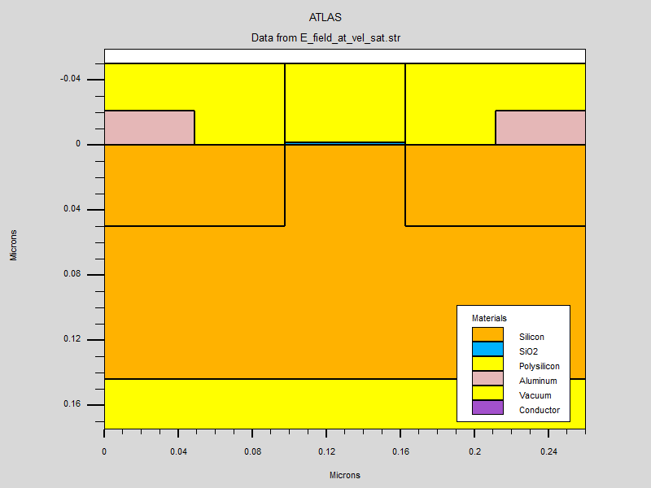
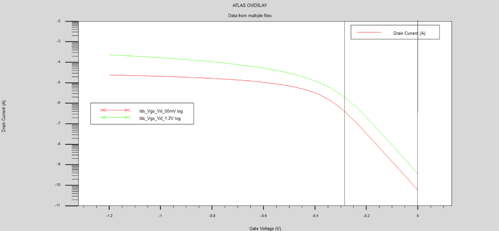
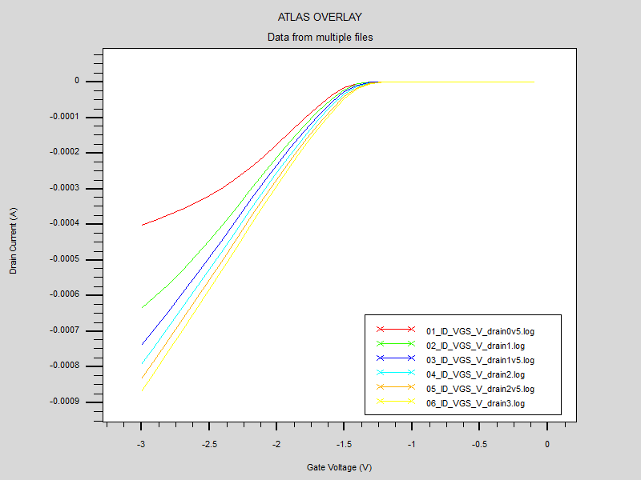
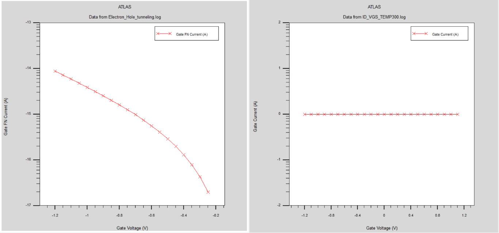
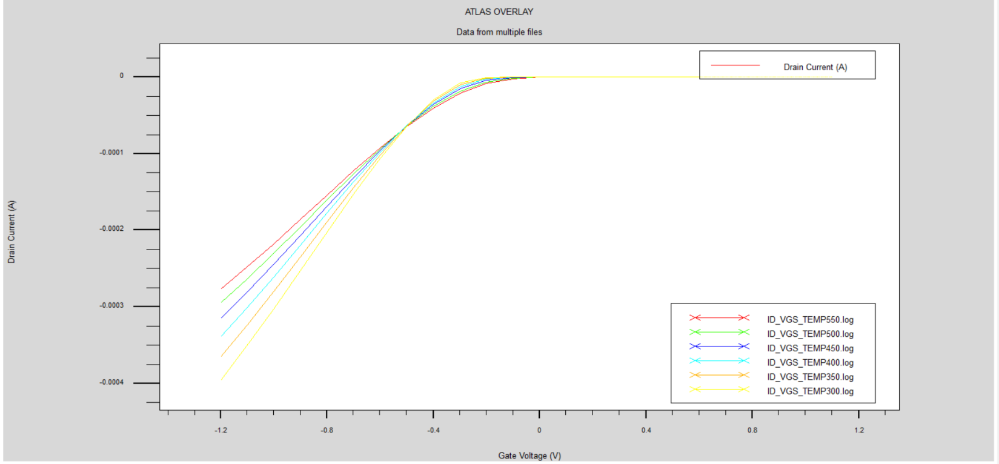

# 65 nm PMOS: Short-Channel Effects in Silvaco ATLAS

[](LICENSE)


TCAD study of a scaled **65 nm-node PMOS transistor**: constant-voltage scaling from a 90 nm baseline, I-V and C-V characteristics, and the main short-channel and non-ideal effects: DIBL, velocity saturation vs. channel-length modulation, gate-oxide tunneling, temperature dependence, and mobility degradation.

<p align="center">
  
  
</p>

## Contents

- [Project overview](#project-overview)
- [Device](#device)
- [Results](#results)
- [Repository layout](#repository-layout)
- [Running the simulation](#running-the-simulation)
- [Known issues](#known-issues)
- [Authors](#authors)
- [License](#license)

## Project overview

The work was delivered in three phases; the full write-up is in [`docs/project_report.pdf`](docs/project_report.pdf).

| Phase | Content |
|-------|---------|
| 1 | Literature review: MOSFET structure, MOS-capacitor physics, design parameters, applications, short-channel challenges |
| 2 | 1 µm NMOS simulation (C-V and I-V) to validate the theory |
| 3 | 1 µm vs. 65 nm PMOS: scaling, I-V/C-V, tunneling, DIBL, CLM vs. velocity saturation, temperature, junction-depth and channel-length effects, on/off-current optimization |

## Device

Constant-voltage scaling with k = 65/90 ≈ 0.722 (V<sub>dd</sub> stays at 1.2 V). The device has a p+ polysilicon gate on SiO₂ over an n-type substrate.

| Parameter | 90 nm baseline | 65 nm device |
|-----------|----------------|--------------|
| Gate length L | 90 nm | 65 nm |
| Gate width W | 10 L | 10 L |
| Oxide thickness t<sub>ox</sub> | 2 nm | 1.444 nm |
| S/D junction depth | 60 nm | 43.3 nm |
| S/D doping (p+) | 1×10¹⁹ cm⁻³ | 1.917×10¹⁹ cm⁻³ |
| Substrate doping (n) | 1×10¹⁸ cm⁻³ | 1.917×10¹⁸ cm⁻³ |
| Substrate depth | 200 nm | 144.4 nm |
| V<sub>dd</sub> | 1.2 V | 1.2 V |

Physical models: `MOS fermi CVT srh auger`. The tunneling runs add `qtnlsc.el qtnlsc.ho`.

## Results

| Metric | Result |
|--------|--------|
| Threshold voltage (hand calculation, p+ poly gate) | V<sub>T</sub> ≈ −0.279 V |
| DIBL | ≈ 58.2 mV/V |
| Lateral field at V<sub>D</sub> = −0.5 V | 832 kV/cm (65 nm) vs. 345 kV/cm (1 µm) |
| Saturation mechanism at V<sub>G</sub> = −2 V | Velocity saturation (65 nm); channel-length modulation (1 µm) |
| Gate tunneling | Finite, exponentially rising gate current with tunneling models enabled; negligible without |
| Temperature, 300 to 550 K | \|V<sub>th</sub>\| falls from 0.232 V to 0.127 V; g<sub>m</sub> peak falls; r<sub>o</sub> rises |
| Optimized on/off currents | I<sub>on</sub> = 329.9 µA, I<sub>off</sub> = 0.69 nA (see [known issues](docs/KNOWN_ISSUES.md)) |

<p align="center">
  
  
  
</p>
<p align="center"><em>DIBL · gate-oxide tunneling · temperature dependence</em></p>

More figures from the report are in [`docs/figures/`](docs/figures/), named `fig-<page>-<index>.png` (page numbers refer to the original report).

## Repository layout

```
.
├── README.md
├── LICENSE
├── CITATION.cff
├── assets/                          # Figures used in this README
├── simulation/
│   └── pmos_65nm_sce_analysis.in    # Silvaco ATLAS / DeckBuild input deck
└── docs/
    ├── project_report.pdf           # Full project report
    ├── deck_to_report_map.md        # Deck sections → report results
    ├── KNOWN_ISSUES.md              # Open items and inconsistencies
    └── figures/                     # Images extracted from the report
```

## Running the simulation

Requires **Silvaco ATLAS with DeckBuild** (commercial; not included).

```bash
deckbuild -run -ascii simulation/pmos_65nm_sce_analysis.in
```

Or open the `.in` file in the DeckBuild GUI. The deck sets `simflags = "-p 12"` (12 parallel threads); adjust to your machine. It is one sequential run: later sections `load` the saved equilibrium solution, so run it top to bottom. Generated `.log` and `.str` files are git-ignored. See [`docs/deck_to_report_map.md`](docs/deck_to_report_map.md) for which section produces which result.

## Known issues

Several analyses in the deck are commented out, and a few numbers in the report disagree with the deck. These are listed in [`docs/KNOWN_ISSUES.md`](docs/KNOWN_ISSUES.md).

## Authors

- Abdullah Afifi
- Ahmed Yasser
- Mohamad Ibrahim
- Ammar AbdElaal
- Omar Ashraf

## License

The simulation deck and repository code are released under the [MIT License](LICENSE). The report may include third-party figures marked "Reprinted from [n]"; those remain the property of their original publishers.
